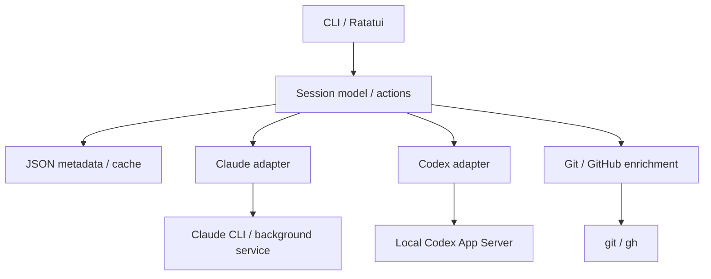

# agnt — デザインドック

- 日付: 2026-09-13
- ステータス: **Draft / 実装前**
- 対応ADR: [adr/0001-architecture.md](adr/0001-architecture.md)
- 想定環境: ローカルのmacOS／LinuxとGhostty。最初の検証OSは実装着手時に選ぶ

## 1. 目的と設計の前提

**agntは、Claude CodeとCodexのセッションを一つの一覧で見つけ、必要な作業へすばやく戻るためのTUIである。**

セッションの短い内容、実行状態、作業の分類、作業場所、PR／issueを一画面で把握できるようにする。任意のディレクトリから起動でき、一覧へ戻った後も実行中の処理を維持することを目指す。

名前は確定している。Rust、JSON、公式連携優先は本書の採用提案である。バックグラウンド実行と標準CLI画面の接続・離脱は別の検証対象とし、tmuxなしの構成が実機で確認済みとは扱わない。

## 2. 要件と対象範囲

| ID | 要件 | 初期版の設計 | 受け入れの基準 |
| --- | --- | --- | --- |
| R01 | Ghosttyから起動できる | 通常のCLIとしてagntを実行 | 端末固有の設定なしで一覧が開く |
| R02 | 両ツールのセッションを一覧表示 | アダプタで発見結果を統合 | 対象範囲と取得失敗が分かり、同じ会話を重複表示しない |
| R03 | 簡易な内容が分かる | タイトル＋短いプレビュー | 会話全文を開かず作業を識別できる |
| R04 | ステータスで分類できる | 実行状態／手動の作業分類を切替 | 承認待ちなどを優先表示できる |
| R05 | PR／issueが分かる | URLの明示登録とGitHub補完 | 関連番号・種別が一覧に表示される |
| R06 | セッションを削除できる | 一覧から非表示、復元可能 | 再取得しても復活しない。履歴は残ることが分かる |
| R07 | 任意ディレクトリから起動 | cwdを指定して起動 | Git管理外、空白、日本語を含むパスも扱える |
| R08 | 高速 | 描画と外部I/Oを分離 | 第11節の暫定性能目標を計測する |
| R09 | 一覧に戻っても処理が続く | 公式の実行基盤を第一候補とする | 長い処理を中断せず、一覧へ戻って再接続できる |

R06の「削除」は履歴の完全削除とは異なるため、初期仕様として確認が必要である。

### 発見するセッションの範囲

| 区分 | 表示 | 状態・操作の保証 |
| --- | --- | --- |
| agntから起動したセッション | 必須 | 選定した実行基盤の対応範囲で起動・接続・停止 |
| 外部で起動したライブセッション | 公式の発見手段が返すものを表示 | 実行場所を特定できない場合は状態Unknown、接続未対応を明示 |
| 保存済みの過去セッション | 履歴プロバイダーで取得可能なものを表示 | 再開可能でも現在の実行状態は別途確認 |
| クラウド、他端末、削除済み履歴 | 初期版の対象外 | ローカル管理の範囲外として区別 |

Claudeのagent view用JSON一覧だけでは、すべての過去の通常セッションを網羅したことにならない。履歴列挙の公式手段・依存関係をP0で調査する。必要ならバージョン別の読取り専用履歴リーダーを採用するが、その判断と対象形式を明示する。未実装のまま「全履歴対応」と表示しない。

### 初期版で増やさない機能

- エージェント間の自動指示・調整、タスク分解。
- 独自モデル接続、独自認証管理、LLMによる要約生成。
- worktreeの自動作成・削除、ブランチやPR／issueの作成・更新。
- Web UI、クラウド同期、通知サービス。
- 動的アダプタプラグイン、履歴の全文検索。
- Windows対応およびGhostty／管理TUI終了後の継続保証。必要性を別途確認する。

## 3. 操作と画面

以下はagntの提案インターフェースであり、既存のコマンドではない。

```sh
agnt                                      # 全体の一覧
agnt list --json                           # スクリプト向け一覧
agnt new claude --cwd ~/src/api            # 初期プロンプト等を入力して起動
agnt new codex --cwd ~/src/api
agnt attach <id>                           # 接続可能なら実行中の会話へ接続
agnt resume <id>                           # 保存済み会話を再開
agnt hide <id>                             # 一覧から削除
agnt restore <id>                          # 非表示を解除
agnt stop <id>                             # 実行を停止
agnt link <id> <url>                        # PR／issueを関連付け
agnt doctor                                # 対応機能、バージョン、接続状態
```

IDは表示用の短縮形を許すが、曖昧なIDを先頭一致で勝手に選ばない。内部ではプロバイダー・ストレージの範囲・ネイティブ会話IDで識別する。

### 一覧の例

| 状態 | Agent | 内容 | 作業場所／ブランチ | 関連 |
| --- | --- | --- | --- | --- |
| 承認待ち | Claude | 認証処理の修正 | api / fix-auth | PR #123 · issue #98 |
| 作業中 | Codex | flaky testの調査 | api / fix-tests | issue #105 |
| 待機 | Claude | READMEの整理 | docs / main | — |

これは架空の表示例である。選択行の下には、短い最新プレビュー、絶対パス、最終観測時刻を表示する。狭い端末ではブランチや関連情報を詳細欄へ移し、状態と内容を優先する。色だけで状態を表現しない。

| 一覧でのキー | 操作 |
| --- | --- |
| j/k、上下 | 行移動 |
| Enter | 実行中なら接続、停止済みなら再開。判断できない場合は操作を選ぶ |
| n | Agent、cwd、初期プロンプトを入力して新規起動 |
| / | タイトル、パス、関連番号のローカル検索 |
| Tab | 実行状態別／作業分類別のグループ切替 |
| m | 作業分類の変更 |
| l | PR／issue URLの登録・編集 |
| d | 削除ダイアログ。実行中なら継続して非表示／停止後に非表示を選ぶ |
| r | 非同期更新を要求 |
| q | 一覧を終了。セッションへの影響は選定した実行基盤の仕様を表示 |

上記のキーは一覧が端末を所有している場合だけ有効。公式CLI画面を開いている間はそのCLIのキー操作に従う。共通の「一覧へ戻る」キーはP0の結果で決める。端末所有を渡したままagntがキーを横取りできるとは仮定しない。

## 4. アーキテクチャ



図は公式連携案の責任分担を示す。CLI画面への接続時の端末移譲は第7節で扱う。

### Rustの構成案

一つのCargo packageから始め、必要性が出るまで複数crateに分けない。

| モジュール | 責務 |
| --- | --- |
| cli | clapによる引数解析と非対話出力 |
| app | イベントループ、操作の実行、メモリ状態の更新 |
| model | Session、RuntimeState、WorkflowState、Link、Capability |
| ui | 一覧、入力、詳細、確認画面 |
| providers/claude | Claudeの発見・起動・接続・観測 |
| providers/codex | App Serverの接続・履歴・通知・機能検出 |
| terminal | 端末の所有権移譲、raw mode等の復元 |
| storage | メタデータ、キャッシュ、排他、スキーマ移行 |
| git / github | cwdからのGit情報取得とリンク補完 |

UI状態の更新は一つのイベントループに集約する。CLIプロセス、App Server通知、GitHub照会はバックグラウンドタスクからイベントを送る。遅い処理を描画関数から呼ばない。可視行の更新はまとめるが、承認待ちやエラーを黙って捨てない。

## 5. セッションと状態のモデル

### セッション識別

セッションの恒久的なキーは `provider + scope + native_session_id` とする。scopeはローカルプロファイル／ストレージ領域の安定した識別子で、PIDや一時的なソケット名ではない。標準プロファイルはdefaultとする。

Claudeの背景ジョブIDや実行PID、Codexの接続先・ロード状態はRuntimeHandleに分離する。同じ会話への接続クライアントを別の会話として重複表示しない。複数実行が同じ会話を共有していると判明した場合は、実行単位を詳細で示す。

起動直後はagnt側の一時operation_idで行を作り、ネイティブID取得後に正式キーへ結び直す。forkによってIDが変わった場合は新しい会話として登録し、親との関係を保持する。

### 主なフィールド

| フィールド | 意味・正本 |
| --- | --- |
| key | プロバイダー、scope、ネイティブ会話ID |
| title / preview | プロバイダー由来。手動タイトルを表示時に優先 |
| cwd | セッションの作業場所。agntの起動場所と区別 |
| launch_git / observed_git | 起動時点のGit情報と、現在観測した情報 |
| runtime | RuntimeHandle、実行状態、根拠、観測時刻 |
| workflow | ユーザーが設定した分類 |
| links | 種別、URL、repo、番号、出所、関連付けの根拠 |
| capabilities | 接続、再開、停止、履歴取得等の対応可否 |
| origin | managed / discovered / history |
| hidden_at | agntの一覧から非表示にした時刻 |

### 実行状態

| 状態 | 表示 | 判断 |
| --- | --- | --- |
| Starting | 起動中 | 起動要求を受け、結果を待っている |
| Running | 作業中 | 信頼できるプロバイダー情報が実行中を示す |
| WaitingApproval | 承認待ち | 明示的な承認要求 |
| WaitingInput | 入力待ち | 明示的な質問・入力要求 |
| Idle | 待機 | 実行環境が生存し、現在のターンが動いていない |
| Stopped | 停止 | 管理する実行の停止・終了を確認した |
| Error | エラー | ツールが実行失敗を報告した |
| Unknown | 不明 | 未観測、古い観測、接続先不明、仕様上判定不能 |

通常の応答終了はIdleへ移す候補であり、WorkflowStateのDoneにはしない。プロバイダーのdoneも、実行環境の生存情報と合わせて解釈する。CodexのnotLoadedだけでは、他の実行環境でも停止しているとは判断しない。

取得通信の失敗はセッション自身のErrorにしない。古い観測はlast_known_stateとして保持し、一覧ではUnknownまたは「未確認」を示す。再接続後にスナップショットを取り直すまで、古いイベントで状態を上書きしない。

作業の分類は `Unclassified / InProgress / Review / Done`。ユーザーが変更し、再実行やPRマージによって自動変更しない。

既定の表示順は承認待ち・入力待ち、エラー、作業中、起動中、待機、停止、不明とし、グループ内は直近活動順。選択中の行はIDで維持する。

## 6. データ取得とアダプタ

アダプタは概念上、次の操作を提供する。詳細なRust traitは実装段階で定める。

| 操作 | 契約 |
| --- | --- |
| capabilities | 実行中のバージョンで対応する機能を返す |
| discover | ページ単位のセッションと取得範囲を返す |
| observe | 更新イベント、またはポーリングで状態差分を返す |
| preview | サイズ制限付きの短い内容を返す |
| start | cwdと入力を受け、ネイティブIDとRuntimeHandleを返す |
| attach | 実行中の会話へ接続する計画を返す |
| resume | 保存済み会話を再開する。attachと混同しない |
| stop | 対象実行の停止を要求し、終了確認を別途返す |

### Claude

ライブ／背景セッションには公式JSON一覧を使う。短いジョブIDを操作用、会話UUIDを識別用に保持する。JSON一覧にタイトル・要約・PRがすべて含まれるとは仮定せず、不足項目は明示的なメタデータや別の読取り手段で補う。[Claude agent view](https://code.claude.com/docs/en/agent-view)

初期プロンプトを伴う背景起動を優先する。空のセッション起動、cwdとworktreeの挙動、既存の設定継承はP0で確認する。agntから要求しないworktree作成を引き起こす場合、その既定値を制御できるか確認し、不可なら動作をUIに明示する。

### Codex

保存済み会話と実行通知はApp Serverを通じて取得する。agntから起動する会話は選定したローカルサーバーへ集約する案とする。プロトコルの初期化と対応機能を確認し、接続は描画から独立して保持する。[Codex App Server](https://learn.chatgpt.com/docs/app-server)

外部で起動したCodexは、同じ履歴領域に見つかっても実行場所が分からなければUnknownとする。生存不明のまま同じ会話を再開して二重実行を作らない。ユーザーが再開する場合は、この不確実性を操作画面で示す。

### 共通の制約

- プロバイダーが未インストールでも、もう一方とagntのメタデータは使える。
- 未知のJSONフィールドは許容し、必須フィールド欠落や未知の状態は診断可能にする。
- CLI呼出しは引数配列とcwdを使い、ユーザー入力をshell文字列として組み立てない。
- バージョン差で未対応ならdoctorに理由を表示し、別操作へ黙って置換しない。
- 読取り失敗時に既存行やメタデータを削除しない。

## 7. 実行・接続・一覧への復帰

### 公式連携案

agntは一覧と観測を担当し、実行は公式サービスが保持する。新規起動の前に操作を一意に記録し、タイムアウト時は結果不明として照合する。起動の自動再試行で重複セッションを作らない。

接続時は一覧の入力・描画を止め、raw modeやalternate screenを適切に解除して公式CLIへ端末を渡す。agnt自体とバックグラウンドの観測タスクは生存させる。子CLIから戻ったら端末状態を復元し、一覧を再描画する。panicや子プロセス異常終了でも端末が使えるよう復元処理を持つ。

Claudeの背景セッションには公式の離脱操作がある。シェルからのattachでCtrl+Zが呼出し元へ戻る動作を、自作TUIを親にした状態でも検証する。[Claudeの接続・離脱](https://code.claude.com/docs/en/agent-view)

Codexは標準画面への接続とその終了をP0で検証する。agntの観測接続を維持するだけで全要求を扱えるとは仮定しない。承認・入力要求の配送先、接続を閉じた場合の扱い、再接続で保留要求を復元できるかを確認する。公式プロトコルは承認をクライアントへの要求として扱うため、サーバーの生存だけでは要件充足を保証できない。[Codexの承認プロトコル](https://learn.chatgpt.com/docs/app-server)

管理側と標準CLIが同時に要求を受け取る場合、どちらが応答責任を持つかを決める。未応答要求が失われる、勝手に拒否される、二重応答する構成は採用しない。必要な承認・質問はセッションを開いて回答し、その後一覧へ戻れることを確認する。

### サービスの寿命

独立したローカルサービスを使うなら、TUIの子stdioプロセスが終了した後も生存するとは仮定しない。起動方法、接続先、所有者、再接続を明示する。既存のユーザーサービスに接続した場合、agnt終了時にそれを停止しない。

初期版の保証目標は「agntの一覧が開いている間、別セッションの処理が続く」。agnt終了・Ghostty終了・マシン再起動後の継続は別要件とする。正常終了、SIGHUP、異常終了の実際の結果はP0で記録し、保証範囲を最終化する。

### PTYへ変更する場合

アダプタの実行部分をPTY所有者に置き換える。非表示中も出力を読み続け、上限付きのスクロール履歴と端末画面状態を保持する。出力を放置するとPTYのバッファが詰まって子プロセスを止め得る。生の出力ログだけでは画面の再構築を保証できない。

必要になるのは端末エミュレーション、リサイズ、日本語・結合文字、入力・マウス・貼付け、端末からの問い合わせへの対応である。Ratatuiはこの役割を代替しない。単なるSIGSTOPやシェルのジョブ制御で一覧へ戻す方式は、作業の継続要件を満たさない。

## 8. 永続化

パスはXDG等のOS標準に従う解決関数を使う。以下は論理的な配置であり、特定OSの絶対パスを固定しない。

| ファイル | 内容 | 正本か |
| --- | --- | --- |
| config.toml | 任意の設定、CLIパス、接続先等 | 設定の正本 |
| metadata.json | 手動タイトル、分類、リンク、非表示 | agntメタデータの正本 |
| metadata.lock | 更新中の排他 | データではない |
| sessions-cache.json | 上限付きの一覧スナップショット | 再生成可能。壊れたら破棄可能 |

設定ファイルはなくても起動できる。キャッシュは1,000行程度を初期上限案とし、会話本文を含めない。キャッシュの状態は起動時に「前回の観測」として表示し、実行中を確定表示しない。

metadata.jsonの例:

```json
{
  "schema_version": 1,
  "revision": 1,
  "sessions": [
    {
      "key": {
        "provider": "codex",
        "scope": "default",
        "native_session_id": "example-session-id"
      },
      "title_override": "認証処理の修正",
      "workflow": "review",
      "hidden_at": null,
      "links": [
        {
          "kind": "pull_request",
          "url": "https://github.com/example/api/pull/123",
          "source": "manual"
        }
      ]
    }
  ]
}
```

ID・URLは例示用である。

更新はロック取得、現行JSON再読込、変更適用、一時ファイルへの書込みとflush／必要な同期、rename、ロック解除の順に行う。データファイル自体ではなく、renameで置き換わらない専用ファイルをロックする。ネットワーク照会中はロックを保持しない。

スキーマ不明やJSON破損時は原本を上書きしない。メタデータ編集を停止して診断を示し、プロバイダーからの一覧表示は可能な範囲で続ける。キャッシュ破損は破棄して再取得する。更新頻度の高い観測データと手動メタデータを分け、不要な全体書込みを避ける。

## 9. 内容・PR・issueの表示

タイトルは、手動タイトル、プロバイダーの名前、取得可能な最初の依頼文の抜粋、短縮IDの順で決める。プレビューは既存の短い内容を優先し、取得できない場合は「内容未取得」とする。独自のモデル呼出しは行わない。

リンクの優先順位は、手動登録、プロバイダーが明示した関連、リポジトリ／ブランチからの候補とする。候補は手動情報を上書きせず、推定であることを示す。複数PR／issueの登録を許す。

GitHub連携では認証済みghを利用する。ghがなくてもURLの登録・表示は使える。GitHubへのアクセスは読取り専用とし、URLを開く操作はユーザー操作に限定する。

ブランチからの照合はリポジトリ、head側のリポジトリ、ブランチを根拠として候補を集める。同名ブランチ、fork、複数PRがある場合は一つに決めつけない。PRのclosingIssuesReferencesはissue候補の一部として利用できるが、全関連issueの一覧ではない。[GitHub CLI](https://cli.github.com/manual/gh_pr_view)

起動時のcwd・Git情報とリンク付与時の根拠を保存する。作業ディレクトリのHEADが後から変わっても、過去の関連付けを自動で付け替えない。複数セッションが同一cwdを共有する場合、現在のHEADだけで特定会話のブランチを確定しない。

セッション一覧に出す外部テキストは制御文字を除去し、表示幅で切り詰める。保存済みプレビューが端末制御として実行されないようにする。

## 10. 停止・削除・復元

hideはmetadata.jsonにhidden_atを記録する。発見処理より後で非表示フィルターを適用するため、バックグラウンド更新によって行が戻らない。restoreはその記録を解除する。非表示行は専用フィルターで確認できる。

実行中の削除ダイアログでは、履歴が残ることと、継続して非表示にするか停止後に非表示にするかを説明する。「停止後」を選んだ場合は停止確認を待ち、失敗・タイムアウト時に黙って非表示にしない。

stopはプロバイダーの正式な操作を優先し、agntが確実に所有する実行に限定してプロセス操作を検討する。古いPIDだけを使ってkillしない。実行場所不明なら停止未対応として表示する。入力待ちを解消するために自動承認はしない。

履歴の完全削除、worktree削除、ブランチ削除は初期版では実行しない。特にClaudeのrmとCodexのdeleteをhideへ機械的に対応付けない。[Claude管理操作](https://code.claude.com/docs/en/agent-view)、[Codex CLI](https://learn.chatgpt.com/docs/developer-commands?surface=cli)

## 11. 性能設計

以下は未計測の目標値であり、性能保証ではない。release build、ローカルSSD、1,000行のキャッシュ、ライブ10セッション、100回の計測を初期条件とし、OS・CPU・CLIバージョン・キャッシュ有無を記録する。

| 指標 | 暫定目標 |
| --- | --- |
| プロセス起動からキャッシュ一覧の初回描画 | p95 100 ms以内 |
| キャッシュなしの初回UI描画 | p95 200 ms以内。取得中表示でも可 |
| キー入力からローカル表示更新 | p95 50 ms以内 |
| 取得済みイベントのUI反映 | p95 100 ms以内 |
| 更新のない一覧のCPU | 試験環境の1コア換算で平均1%未満を目安 |

初回の最新データ取得時間と公式CLIへの接続時間は別に測り、上記の描画時間に紛れ込ませない。プロバイダーの起動時間やGitHub往復時間も報告する。

Claudeは初期案として2秒間隔で一括ポーリングし、重複実行を避ける。非表示中は間隔を延ばし、失敗時はバックオフする。Codexは通知と再接続時のスナップショットを使う。通知が利用できないバージョンでは機能を縮退する。

GitHub照会はリポジトリ／ブランチまたはURL単位でまとめ、TTLは初期案60秒。同時照会数を制限する。通信不能時は最終取得値と時刻を残す。イベント駆動の描画とし、変化がない状態で高頻度に再描画しない。

## 12. 失敗時の動作

| 状況 | 動作 |
| --- | --- |
| CLIが未インストール・未対応 | そのプロバイダーの状態と理由を表示し、もう一方は使える |
| CLIの一覧取得が遅い | タイムアウト、バックオフ、キャッシュ継続表示 |
| App Serverの接続断 | 対象状態を未確認にし、再接続後に照合 |
| 起動結果の受信前に接続断 | 結果不明として照合。新規起動を自動再試行しない |
| cwdが消失 | 開始を失敗させ、別cwdへの変更は明示操作にする |
| Git管理外のcwd | ブランチは空欄。セッションは起動可能 |
| GitHubが使えない | 保存済みリンクを表示し、照会の失敗を補助表示 |
| メタデータの排他競合 | 短い待機後に再試行。UIは停止しない |
| 未知の状態値 | Unknownと診断情報。完了や停止へ変換しない |
| 公式画面の異常終了 | 端末を復元し、実行状態を再観測 |

## 13. 実装と検証の順序

### P0: 実行基盤を選ぶための技術検証

UIの見た目を作り込む前に実施する。この段階の目的は仕様の不確実性を解消することで、製品完成を意味しない。

| 検証 | 合格条件・記録する事項 |
| --- | --- |
| 実際のJSON／APIを取得 | タイトル、状態、ID、履歴範囲を記録し、対応表を作る |
| 新規起動とID取得 | cwdを守り、重複起動なく正式IDへ結び付く |
| Claudeの起動・attach・復帰 | 作業中にagntへ戻り、同じ会話と処理に再接続できる |
| Codexの起動・標準画面接続・復帰 | ターンを中断せずagntへ戻り、継続中または完了した処理を確認できる |
| 承認待ち・入力待ちでの復帰 | 未応答要求が失われず、再接続して回答できる |
| 同時クライアント | 観測接続と標準画面で要求が二重処理されない |
| サービスの寿命 | agnt正常終了、Ghostty終了、接続断の結果を区別して記録 |
| 外部セッションと過去履歴 | 発見・状態・再開の範囲を確認。Claudeの履歴列挙方法を選ぶ |
| 端末復元 | raw mode、カーソル、サイズ、貼付けが復帰後に正常 |

Codexの標準画面との往復が不成立なら、PTY、独自Codex UI、tmuxのコストを比較し、ADR-0001を更新してから次へ進む。tmux導入を決定済みとして扱わない。

### P1: 最小の利用経路

一覧統合、状態と内容表示、任意cwdでの起動、接続・再開、一覧への復帰、JSONの非表示・復元を実装する。両者でR09を満たすまで切り替え機能を完了扱いにしない。

### P2: 管理情報

手動分類、タイトル、PR／issue登録、GitHub補完、対象範囲が明確な履歴表示を仕上げる。

### P3: 完成条件の確認

重大な失敗経路と性能を検証する。テストは次の具体的なリスクに絞る。

- 二つの更新プロセスでも、分類変更とリンク追加を失わない。
- JSON保存途中の失敗で元のメタデータを壊さない。
- hideしたセッションが再発見で復活しない。
- notLoaded、未知の値、古い通知で状態を誤認しない。
- 起動タイムアウトを再試行して二重セッションを作らない。
- 同一cwdのブランチ変更で過去PRを付け替えない。
- 実行中／承認待ちからの往復で処理・要求が維持される。
- GitHubや片方のCLIの障害でもキー入力と一覧が使える。
- 上記の性能目標を実測し、未達理由と改善を記録する。

## 14. 未決定事項

| ID | 判断すること | 判断のタイミング |
| --- | --- | --- |
| Q1 | Codex標準CLIの非中断離脱と要求配送 | P0。実行基盤を決める前 |
| Q2 | 公式CLI画面の維持をどこまで必須にするか | P0で公式連携が不成立の場合 |
| Q3 | agnt／Ghostty終了後も継続を保証するか | サービスの寿命を確定する前 |
| Q4 | 過去の通常Claudeセッションをどう列挙するか | P0。R02の範囲を決める前 |
| Q5 | 削除は一覧非表示で十分か | 初期仕様の受け入れ時 |
| Q6 | 最初のOS、最低CLIバージョン、ライブラリ版 | 実装開始とP0 |

本書のAPI・ライブラリに関する記述は参照した公式資料に基づく。ユーザーのローカル環境での実測、各CLIの導入・起動、agntの実装はまだ行っていない。
