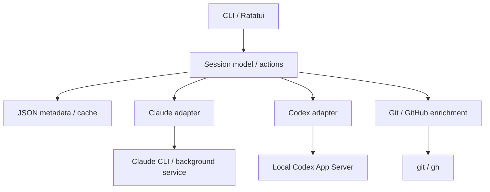

# agnt — design doc

- Date: 2026-09-13
- Status: **Draft / before implementation**
- Corresponding ADR: [adr/0001-architecture.md](adr/0001-architecture.md)
- Target environment: local macOS / Linux with Ghostty. The first OS to validate on is chosen when implementation starts

## 1. Purpose and design premises

**agnt is a TUI for finding Claude Code and Codex sessions in one list and getting back to the work you need quickly.**

One screen shows a session's short content, execution state, work classification, working directory, and PR / issue. It can start from any directory, and it aims to keep running work alive after returning to the list.

The name is settled. Rust, JSON, and a preference for official integration are this document's proposals. Background execution and attaching to or leaving the standard CLI screen are separate things to validate; a setup without tmux is not treated as confirmed on a real machine.

## 2. Requirements and scope

| ID | Requirement | First-version design | Acceptance criterion |
| --- | --- | --- | --- |
| R01 | Starts from Ghostty | Run agnt as an ordinary CLI | The list opens with no terminal-specific settings |
| R02 | Lists both tools' sessions | Merge discovery results in adapters | The scope and any fetch failures are visible, and one conversation is not listed twice |
| R03 | Shows what a session is about | Title plus a short preview | Work is identifiable without opening the full conversation |
| R04 | Sorts by status | Toggle between execution state and manual work classification | Things like waiting-for-approval can be shown first |
| R05 | Shows PRs and issues | Explicit URL registration plus GitHub enrichment | The related number and kind appear in the list |
| R06 | Deletes a session | Hide from the list, restorable | It does not come back on refetch, and it is clear that history remains |
| R07 | Starts in any directory | Start with a given cwd | Paths outside git, with spaces, or with non-ASCII characters all work |
| R08 | Fast | Separate drawing from external I/O | The provisional performance targets in section 11 are measured |
| R09 | Work continues after returning to the list | Prefer the official runtime | A long-running task is not interrupted, and the list can reattach to it |

R06's "delete" differs from full history deletion, so it needs confirmation as an initial specification.

### Scope of session discovery

| Category | Display | Guarantee on state and operations |
| --- | --- | --- |
| Sessions started by agnt | Required | Start, attach, and stop within the chosen runtime's scope |
| Live sessions started elsewhere | Whatever the official discovery returns | If the execution location cannot be determined, state is Unknown and attach is marked unsupported |
| Saved past sessions | Whatever the history provider can retrieve | Resumable does not mean the current execution state is known; that is checked separately |
| Cloud, other machines, deleted history | Outside the first version's scope | Distinguished as outside the scope of local management |

Claude's agent-view JSON list alone does not cover every past ordinary session. P0 investigates the official means of enumerating history and its dependencies. If a version-specific read-only history reader is needed, that decision and the target formats are stated explicitly. "Full history support" is never displayed while it is unimplemented.

### Features not added in the first version

- Automatic instruction and coordination between agents, and task decomposition.
- Custom model connections, custom authentication management, and LLM-generated summaries.
- Automatic worktree creation and deletion, and creating or updating branches, PRs, or issues.
- Web UI, cloud sync, and notification services.
- Dynamic adapter plugins and full-text history search.
- Windows support, and any guarantee that work continues after Ghostty or the managing TUI exits. The need for these is confirmed separately.

## 3. Operations and screens

The following is agnt's proposed interface, not an existing command.

```sh
agnt                                       # the whole list
agnt list --json                           # list for scripts
agnt new claude --cwd ~/src/api            # start with an initial prompt and so on
agnt new codex --cwd ~/src/api
agnt attach <id>                           # attach to a running conversation, if possible
agnt resume <id>                           # reopen a saved conversation
agnt hide <id>                             # remove from the list
agnt restore <id>                          # undo hiding
agnt stop <id>                             # stop execution
agnt link <id> <url>                       # associate a PR or issue
agnt doctor                                # supported features, versions, connection state
```

IDs may be given in an abbreviated display form, but an ambiguous ID is never resolved by first-prefix match. Internally a session is identified by provider, storage scope, and native conversation ID.

### Example list

| State | Agent | Content | Location / branch | Related |
| --- | --- | --- | --- | --- |
| Waiting approval | Claude | Fix the auth handler | api / fix-auth | PR #123 · issue #98 |
| Running | Codex | Investigate a flaky test | api / fix-tests | issue #105 |
| Idle | Claude | Tidy up the README | docs / main | — |

This is a fictional example. Below the selected row, a short latest preview, the absolute path, and the last observation time are shown. On a narrow terminal, branch and related information move to the detail pane, and state and content take priority. State is never conveyed by colour alone.

| Key in the list | Operation |
| --- | --- |
| j/k, arrows | Move between rows |
| Enter | Attach when running, resume when stopped. When it cannot be decided, ask which operation |
| n | Focus the new-session prompt. The task text is typed; agent and directory carry defaults and are changed with ^a and ^d |
| / | Local search over title, path, and related number |
| Tab | Switch grouping between execution state and work classification |
| m | Change work classification |
| l | Register or edit a PR / issue URL |
| d | Delete dialog. When running, choose between continuing and hiding, or stopping then hiding |
| r | Request an asynchronous refresh |
| q | Leave the list. The effect on sessions follows the chosen runtime's behaviour, which is shown |

The new-session prompt sits below the detail pane and is always on screen, showing the agent and directory a new session would use. Requiring only the task text is deliberate: naming an agent and a path every time was the slowest part of starting work, and both have reasonable defaults.

These keys apply only while the list owns the terminal. While an official CLI screen is open, that CLI's keys apply. The shared "back to the list" key is decided by the P0 results. It is not assumed that agnt can intercept keys while terminal ownership has been handed over.

## 4. Architecture



The diagram shows the division of responsibility in the official-integration option. Handing over the terminal when attaching to a CLI screen is covered in section 7.

### Proposed Rust structure

Start from a single Cargo package, and do not split into several crates until there is a reason to.

| Module | Responsibility |
| --- | --- |
| cli | clap argument parsing and non-interactive output |
| app | Event loop, running operations, updating in-memory state |
| model | Session, RuntimeState, WorkflowState, Link, Capability |
| ui | List, input, detail, confirmation screens |
| providers/claude | Claude discovery, launching, attaching, observation |
| providers/codex | App Server connection, history, notifications, feature detection |
| terminal | Terminal ownership handover, restoring raw mode and the like |
| storage | Metadata, cache, exclusion, schema migration |
| git / github | Git information from a cwd, and link enrichment |

UI state updates are consolidated into a single event loop. CLI processes, App Server notifications, and GitHub queries send events from background tasks. Slow work is never called from a drawing function. Updates to visible rows are batched, but approval requests and errors are never dropped silently.

## 5. The session and state model

### Session identity

A session's permanent key is `provider + scope + native_session_id`. The scope is a stable identifier for a local profile or storage area, not a PID or a temporary socket name. The standard profile is `default`.

Claude's background job ID and execution PID, and Codex's connection target and load state, are separated into a RuntimeHandle. A client attached to the same conversation is never listed as a separate conversation. When several executions turn out to share one conversation, the execution unit is shown in the detail pane.

Right after launching, a row is created under an agnt-side temporary operation_id, then rebound to the permanent key once the native ID is known. When a fork changes the ID, the result is registered as a new conversation that keeps its relationship to the parent.

### Main fields

| Field | Meaning and authoritative source |
| --- | --- |
| key | Provider, scope, native conversation ID |
| title / preview | From the provider. A manual title wins at display time |
| cwd | The session's working directory. Distinct from where agnt was started |
| launch_git / observed_git | Git information at launch, and the currently observed information |
| runtime | RuntimeHandle, execution state, the evidence for it, and the observation time |
| workflow | The classification the user set |
| links | Kind, URL, repo, number, source, and the evidence for the association |
| capabilities | Whether attach, resume, stop, history retrieval and so on are supported |
| origin | managed / discovered / history |
| hidden_at | When the session was hidden from agnt's list |

### Execution state

| State | Display | Basis |
| --- | --- | --- |
| Starting | Starting | A start request was accepted and the result is pending |
| Running | Running | Trustworthy provider information says it is running |
| WaitingApproval | Waiting approval | An explicit approval request |
| WaitingInput | Waiting input | An explicit question or input request |
| Idle | Idle | The execution environment is alive and no turn is currently running |
| Stopped | Stopped | A managed execution's stop or exit was confirmed |
| Error | Error | The tool reported an execution failure |
| Unknown | Unknown | Not observed, an old observation, an unknown location, or undecidable by specification |

The ordinary end of a response is a candidate for moving to Idle, not for WorkflowState's Done. A provider's "done" is interpreted together with information about whether the execution environment is alive. Codex's `notLoaded` alone is not taken to mean the session is stopped in other execution environments too.

A failed fetch is not turned into the session's own Error. An old observation is kept as last_known_state, and the list shows Unknown or "not confirmed". After reconnecting, state is not overwritten with old events until a fresh snapshot is taken.

Work classification is `Unclassified / InProgress / Review / Done`. The user changes it; rerunning or merging a PR never changes it automatically.

The default display order is waiting-for-approval and waiting-for-input, then error, running, starting, idle, stopped, unknown, with the most recent activity first inside a group. The selected row is tracked by ID.

## 6. Data retrieval and adapters

Conceptually, an adapter provides the following operations. The exact Rust trait is settled at implementation time.

| Operation | Contract |
| --- | --- |
| capabilities | Returns the features supported by the running version |
| discover | Returns a page of sessions and the scope that was searched |
| observe | Returns update events, or state differences by polling |
| preview | Returns short content with a size limit |
| start | Takes a cwd and input, returns a native ID and a RuntimeHandle |
| attach | Returns a plan for attaching to a running conversation |
| resume | Reopens a saved conversation. Not to be confused with attach |
| stop | Requests that the execution stop; confirmation of termination is returned separately |

### Claude

Live and background sessions use the official JSON list. The short job ID is kept for operations and the conversation UUID for identity. The JSON list is not assumed to carry title, summary, and PR in full; missing items are filled in from explicit metadata or another read path. [Claude agent view](https://code.claude.com/docs/en/agent-view)

Background launching with an initial prompt takes priority. Starting an empty session, the behaviour of cwd and worktrees, and inheritance of existing settings are checked in P0. If launching causes worktree creation that agnt did not ask for, whether that default can be controlled is checked; if it cannot, the behaviour is stated in the UI.

### Codex

Saved conversations and execution notifications come through the App Server. The proposal is to consolidate conversations started from agnt into the chosen local server. Protocol initialization and supported features are checked, and the connection is held independently of drawing. [Codex App Server](https://learn.chatgpt.com/docs/app-server)

A Codex session started elsewhere is Unknown if its execution location is not known, even when it is found in the same history area. A conversation is never resumed into a double execution while its liveness is unknown. When the user resumes it, this uncertainty is shown in the operation screen.

### Shared constraints

- If one provider is not installed, the other provider and agnt's metadata still work.
- Unknown JSON fields are tolerated; missing required fields and unknown states are diagnosable.
- CLI calls use an argument array and a cwd. User input is never assembled into a shell string.
- When a version difference means something is unsupported, `doctor` shows the reason, and no other operation is silently substituted.
- A failed read never deletes existing rows or metadata.

## 7. Execution, attachment, and returning to the list

### The official-integration option

agnt handles the list and observation, and the official service holds the execution. Before a new launch, the operation is recorded uniquely, so a timeout can be reconciled as an unknown result. Automatic retries of a launch never create duplicate sessions.

When attaching, the list's input and drawing stop, raw mode and the alternate screen are properly undone, and the terminal is handed to the official CLI. agnt itself and its background observation tasks stay alive. When the child CLI returns, the terminal state is restored and the list is redrawn. A restore path exists so the terminal stays usable even after a panic or an abnormal child exit.

Claude's background sessions have an official detach operation. The behaviour where Ctrl+Z from a shell attach returns to the caller is also validated with a custom TUI as the parent. [Claude attach and detach](https://code.claude.com/docs/en/agent-view)

For Codex, attaching to the standard screen and exiting it are validated in P0. It is not assumed that keeping agnt's observation connection alive is enough to handle every request. Where approval and input requests are delivered, what happens when a connection is closed, and whether reconnecting restores pending requests are all checked. Since the official protocol treats approval as a request to the client, a live server alone does not guarantee the requirement is met. [Codex approval protocol](https://learn.chatgpt.com/docs/app-server)

When the managing side and the standard CLI can both receive a request, which one is responsible for answering is decided. A design in which an unanswered request is lost, denied without asking, or answered twice is not adopted. Approvals and questions that need an answer are handled by opening the session, answering, and then returning to the list.

### Service lifetime

If an independent local service is used, it is not assumed to outlive a child stdio process of the TUI. The launch method, the connection target, the owner, and reconnection are all stated. When agnt attaches to an existing user service, it does not stop that service when it exits.

The first version's guarantee target is: "while agnt's list is open, work in another session keeps running." Continuation after agnt exits, after Ghostty exits, or across a machine restart is a separate requirement. The actual results for a normal exit, SIGHUP, and an abnormal exit are recorded in P0, and the guaranteed scope is finalized then.

### If the design changes to PTY

The execution part of an adapter is replaced by a PTY owner. Output keeps being read even while hidden, and a bounded scrollback and the terminal screen state are held. Leaving output unread can fill the PTY buffer and stall the child process. A raw output log alone does not guarantee that the screen can be reconstructed.

What becomes necessary: terminal emulation, resizing, CJK and combining characters, input, mouse and paste handling, and responses to queries from the terminal. Ratatui does not take this role. Returning to the list with a plain SIGSTOP or shell job control does not satisfy the requirement that work continues.

## 8. Persistence

Paths come from a resolver that follows OS conventions such as XDG. The following is a logical layout; no absolute path for a specific OS is fixed.

| File | Contents | Authoritative |
| --- | --- | --- |
| config.toml | Optional settings, CLI paths, connection targets | Yes, for settings |
| metadata.json | Manual titles, classification, links, hidden markers | Yes, for agnt metadata |
| metadata.lock | Exclusion during an update | Not data |
| sessions-cache.json | A bounded snapshot of the list | Regenerable. Can be discarded when broken |

agnt starts without a configuration file. The cache's initial proposed limit is about 1,000 rows, and it never contains conversation content. At startup the cache's states are shown as "the previous observation", never as a confirmed running state.

An example `metadata.json`:

```json
{
  "schema_version": 1,
  "revision": 1,
  "sessions": [
    {
      "key": {
        "provider": "codex",
        "scope": "default",
        "native_session_id": "example-session-id"
      },
      "title_override": "Fix the auth handler",
      "workflow": "review",
      "hidden_at": null,
      "links": [
        {
          "kind": "pull_request",
          "url": "https://github.com/example/api/pull/123",
          "source": "manual"
        }
      ]
    }
  ]
}
```

The IDs and URLs are examples.

An update takes the lock, reloads the current JSON, applies the change, writes to a temporary file with a flush and any needed sync, renames, and releases the lock. The lock is taken on a dedicated file that rename does not replace, not on the data file itself. The lock is not held during network queries.

When the schema is unknown or the JSON is corrupt, the original is not overwritten. Metadata editing stops, a diagnostic is shown, and listing from providers continues as far as it can. A corrupt cache is discarded and refetched. Frequently updated observation data is kept separate from manual metadata to avoid unnecessary whole-file writes.

## 9. Showing content, PRs, and issues

A title is chosen in this order: manual title, the provider's name, an excerpt of the first retrievable request text, then the short ID. A preview prefers existing short content; when none can be retrieved, it shows "no content". No custom model calls are made.

Link priority is: manual registration, an association the provider states explicitly, then candidates derived from repository and branch. A candidate never overwrites manual information, and is marked as an inference. Registering several PRs or issues is allowed.

GitHub integration uses an authenticated `gh`. Registering and displaying URLs still works without `gh`. GitHub access is read-only, and opening a URL is limited to an explicit user action.

Matching from a branch collects candidates on the basis of the repository, the head-side repository, and the branch. When there is a same-named branch, a fork, or several PRs, one is not picked arbitrarily. A PR's closingIssuesReferences can be used as part of the issue candidates, but it is not a list of every related issue. [GitHub CLI](https://cli.github.com/manual/gh_pr_view)

The cwd and git information at launch, and the evidence for each link, are stored. When a working directory's HEAD changes later, past associations are not reassigned automatically. When several sessions share one cwd, the current HEAD alone does not determine a specific conversation's branch.

External text shown in the session list has control characters removed and is truncated to the display width. A stored preview must never be executed as terminal control sequences.

## 10. Stopping, deleting, and restoring

`hide` records `hidden_at` in `metadata.json`. The hidden filter is applied after discovery, so a background refresh never brings a row back. `restore` clears that record. Hidden rows can be inspected through a dedicated filter.

The delete dialog for a running session explains that history remains, and offers the choice between continuing while hidden and stopping before hiding. When "stop first" is chosen, the confirmation of the stop is awaited, and a failure or timeout never hides the row silently.

`stop` prefers the provider's official operation, and process operations are considered only for executions agnt definitely owns. Nothing is killed on the basis of an old PID alone. When the execution location is unknown, stop is shown as unsupported. Approvals are never granted automatically to clear a waiting-for-input state.

Full history deletion, worktree deletion, and branch deletion are not performed in the first version. In particular, Claude's `rm` and Codex's `delete` are not mechanically mapped onto `hide`. [Claude management operations](https://code.claude.com/docs/en/agent-view), [Codex CLI](https://learn.chatgpt.com/docs/developer-commands?surface=cli)

## 11. Performance design

The following are unmeasured targets, not performance guarantees. The initial conditions are a release build, a local SSD, a 1,000-row cache, 10 live sessions, and 100 measurements, recording OS, CPU, CLI version, and whether the cache was present.

| Metric | Provisional target |
| --- | --- |
| Process start to the first draw of the cached list | p95 within 100 ms |
| First UI draw with no cache | p95 within 200 ms. A loading indicator is acceptable |
| Keystroke to a local display update | p95 within 50 ms |
| A retrieved event appearing in the UI | p95 within 100 ms |
| CPU for a list with no updates | Under 1% on average, per core, on the test machine |

The time for the first fresh data fetch and the time to attach to the official CLI are measured separately, not mixed into the drawing times above. Provider startup time and GitHub round-trip time are reported too.

For Claude, the initial proposal is batched polling at a 2-second interval, avoiding overlapping runs. The interval grows while hidden, and failures back off. Codex uses notifications plus a snapshot on reconnect. On versions where notifications are unavailable, the feature degrades.

GitHub queries are batched per repository / branch or per URL, with an initial TTL proposal of 60 seconds and a limit on concurrent queries. When the network is unavailable, the last retrieved value and its timestamp remain. Drawing is event-driven; nothing redraws at a high rate while nothing changes.

## 12. Behaviour on failure

| Situation | Behaviour |
| --- | --- |
| A CLI is not installed or unsupported | Show that provider's state and the reason; the other one still works |
| A CLI's list retrieval is slow | Time out, back off, keep showing the cache |
| The App Server connection drops | Mark the affected state as not confirmed, reconcile after reconnecting |
| The connection drops before a launch result arrives | Treat the result as unknown and reconcile. Do not retry the launch automatically |
| The cwd disappeared | Fail the start; changing to a different cwd is an explicit action |
| The cwd is not under git | Leave the branch blank. The session still starts |
| GitHub is unavailable | Show stored links, with a note about the failed query |
| Metadata lock contention | Retry after a short wait. The UI does not stall |
| An unknown state value | Show Unknown with diagnostic information. Never convert it to done or stopped |
| The official screen exits abnormally | Restore the terminal and re-observe the execution state |

## 13. Implementation and validation order

### P0: technical validation to choose the runtime

Done before polishing the UI's appearance. The purpose of this stage is to remove specification uncertainty, not to finish the product.

| Validation | Pass condition and what to record |
| --- | --- |
| Fetch the real JSON / API | Record title, state, ID, and history scope, and build a mapping table |
| Start a new session and get its ID | The cwd is respected and the row binds to the permanent ID with no duplicate launch |
| Claude start, attach, and return | Return to agnt mid-work and reattach to the same conversation and work |
| Codex start, standard-screen attach, and return | Return to agnt without interrupting the turn, and see work still running or finished |
| Returning while waiting for approval or input | No unanswered request is lost; reattach and answer it |
| Concurrent clients | The observation connection and the standard screen do not both process a request |
| Service lifetime | Record agnt's normal exit, Ghostty's exit, and a dropped connection separately |
| External sessions and past history | Confirm the scope of discovery, state, and resume. Choose how to enumerate Claude's history |
| Terminal restoration | Raw mode, cursor, size, and paste all behave normally after returning |

If the round trip to Codex's standard screen does not work, compare the cost of PTY, a custom Codex UI, and tmux, and update ADR-0001 before moving on. Adopting tmux is not treated as already decided.

### P1: the minimum usable path

Implement list merging, state and content display, starting in any cwd, attach and resume, returning to the list, and hide / restore in JSON. Switching is not treated as complete until R09 holds for both tools.

### P2: management information

Finish manual classification, titles, PR / issue registration, GitHub enrichment, and history display with a clearly defined scope.

### P3: checking the completion conditions

Validate the serious failure paths and performance. Tests focus on these specific risks:

- Two updating processes do not lose a classification change or an added link.
- A failure partway through saving JSON does not corrupt the existing metadata.
- A hidden session does not come back when it is rediscovered.
- `notLoaded`, an unknown value, or an old notification does not cause a wrong state.
- Retrying a launch timeout does not create a duplicate session.
- A branch change in the same cwd does not reassign a past PR.
- A round trip from running or waiting-for-approval preserves the work and the request.
- A GitHub outage or one broken CLI still leaves keystrokes and the list working.
- The performance targets above are measured, with reasons and improvements recorded for any miss.

## 14. Open questions

| ID | What to decide | When to decide |
| --- | --- | --- |
| Q1 | Non-interrupting detach from the Codex standard CLI, and request delivery | P0. Before choosing the runtime |
| Q2 | How strictly keeping the official CLI screen is required | P0, if official integration does not work |
| Q3 | Whether continuation after agnt or Ghostty exits is guaranteed | Before finalizing the service lifetime |
| Q4 | How past ordinary Claude sessions are enumerated | P0. Before settling R02's scope |
| Q5 | Whether hiding from the list is enough for "delete" | When the initial specification is accepted |
| Q6 | The first OS, the minimum CLI versions, and library versions | At implementation start and P0 |

This document's statements about APIs and libraries are based on the official material referenced. Measurement in the user's local environment, installing and starting each CLI, and implementing agnt have not been done yet.
